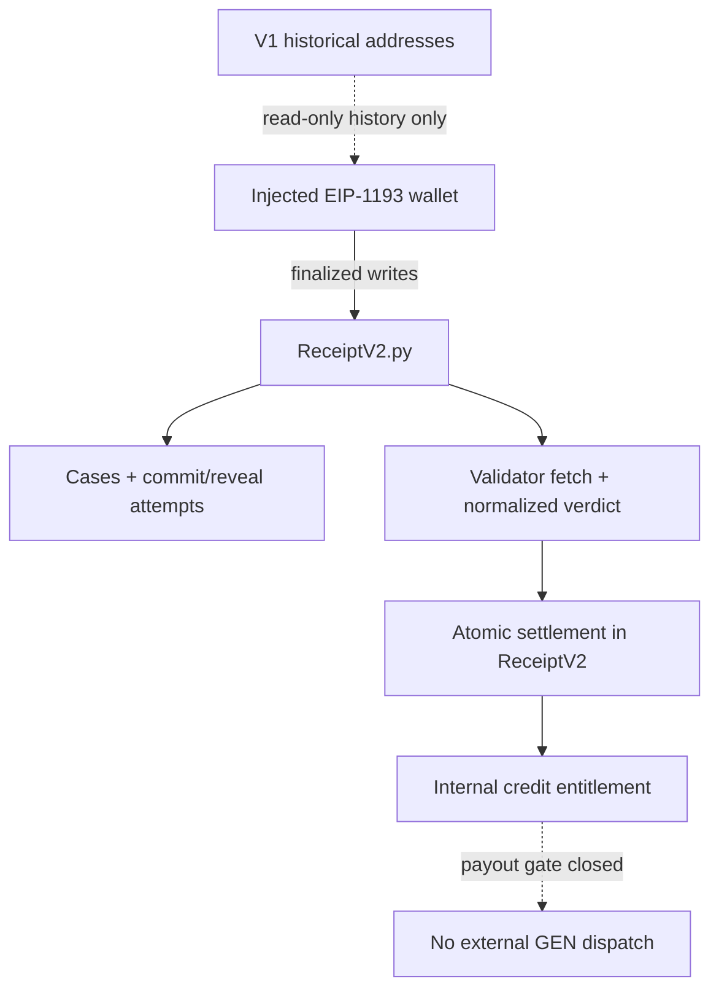

# RECEIPT! V2

RECEIPT! is a source-grounded documentation-claim registry for GenLayer Studionet 61999. V2 consolidates the active adjudication and economic state machine into exactly one Intelligent Contract, `contracts/ReceiptV2.py`.

## Current release status

**NOT_READY for live funding or withdrawals.** The contract is deliberately fail-closed: `funding_enabled` starts false, there is no public activation method, and `withdraw()` never emits an external GEN transfer. This is the only honest status until Studionet exposes an authenticated, receipt-bound failure/recovery path for external GEN messages that can be enforced by one Intelligent Contract.

The V1 `ProofEngine.py` and `PromiseVault.py` sources and their historical deployment evidence remain in the repository for read-only audit/history. V1 balances are not migrated into V2, and `main` is not changed by this branch.

## V2 architecture



ReceiptV2 owns case registration, immutable Git locators and digests, commit/reveal, source fetching, validator agreement, adjudication, expiry, timeout recovery, credits, conservation counters and withdrawal gating. There is no ProofEngine callback, cross-contract binding, resend method, child tombstone or admin recredit path.

## Economic conservation model

While the safety gate is closed:

`accepted_wei = outstanding_wei`

`credited_wei` is the cumulative sum of internal entitlements created by terminal state transitions. It is not additional money. Settlement moves liability from a case/attempt to a wallet credit without changing total outstanding liability. Since V2 never dispatches GEN, `external_dispatch_wei` remains zero. Tests assert this across winning, invalid, inconclusive, unrevealed and expiry paths.

The unresolved boundary is intentional: an external message can be submitted separately from the parent Intelligent Contract transaction, and an ambiguous or failed child cannot currently be authenticated by a later V2 write without risking either double payment or stranded credit. Therefore V2 does not accept a deposit and does not mark a credit paid.

## Exact versions and network

- RPC: `https://studio.genlayer.com/api`
- Chain: `61999` only
- Repository-local GenLayer CLI: `0.39.1`
- Frontend `genlayer-js`: `1.1.8`
- Frontend Next.js: `16.4.0`
- Active source: `contracts/ReceiptV2.py`

## Local validation

```powershell
npm ci
python -m pip install -r requirements.txt
npm run cli -- --version
npm run preflight
npm run lint:contracts
python -m pytest -q tests/unit
python -m pytest -q tests/direct
npm run test:reconciliation
cd frontend
npm ci
npm run typecheck
npm test
npm run lint
npm run build
```

The unit harness is deterministic and labelled as such. Direct Mode is the runtime-level check. Neither substitutes for a finalized live economic lifecycle.

## V2 deployment

The active deployer sends one contract only and refuses non-61999 targets, a non-local CLI, ambiguous retries, or a post-deploy config that is not `SINGLE_IC`, funding-disabled and withdrawal-disabled.

```powershell
npm run deploy:61999 -- --deploy
npm run source:verify
npm run reconcile:v2
```

The script writes gitignored `receipt-v2-deployment.state.json`, `receipt-v2-deployment.manifest.json` and `frontend/.env.local` only after it proves finality and the fresh treasury/config readback. It never enables funding. The old `tools/deploy-studionet.mjs` entry point is a retired V1 guard and cannot deploy the two-contract architecture.

`npm run reconcile:v2` is read-only and reports `DISABLED_NO_DISPATCH` for a verified V2 manifest. The existing `reconcile:withdrawal` command is retained as a V1 historical evidence parser; it must not be used as V2 payment proof.

## Frontend environment

The active app uses one public address:

```text
NEXT_PUBLIC_RECEIPT_V2_ADDRESS=0x...
NEXT_PUBLIC_EXPLORER_URL=https://explorer-studio.genlayer.com
NEXT_PUBLIC_FUNDING_ENABLED=false
```

Optional V1 history-only variables are named `NEXT_PUBLIC_HISTORICAL_PROOF_ENGINE_ADDRESS` and `NEXT_PUBLIC_HISTORICAL_PROMISE_VAULT_ADDRESS`. Never put private keys or signing secrets in `NEXT_PUBLIC_*` variables.

The UI reads finalized V2 state, enforces the injected-wallet chain check, provides commit/reveal/adjudication/recovery actions, and shows internal credits as not withdrawable. It does not display an unverified external dispatch as a payment.

## Evidence and limitations

The authoritative reviewer material is in:

- [`docs/V2_SINGLE_CONTRACT.md`](docs/V2_SINGLE_CONTRACT.md) — architecture and release gate.
- [`docs/V2_PAYOUT_PATTERNS.md`](docs/V2_PAYOUT_PATTERNS.md) — source-backed protocol boundary research.
- [`docs/V2_REVIEW.md`](docs/V2_REVIEW.md) — threat model, method/state references, audit matrix and evidence ledger.
- [`docs/PROTOCOL.md`](docs/PROTOCOL.md) and [`docs/LIVE_VALIDATION.md`](docs/LIVE_VALIDATION.md) — V1 historical protocol/evidence, not V2 certification.

No 5/5/5/5 score, custody safety, production cutover or successful V2 payout is claimed until the missing live proof exists. A source digest proves exact bytes, not authorship, deployment authenticity or whole-system behavior.

MIT licensed. See [`LICENSE`](LICENSE).
