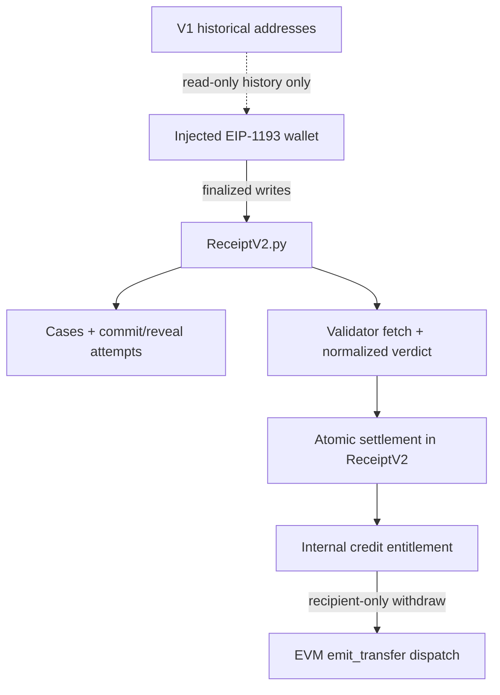

# RECEIPT! V2

RECEIPT! is a source-grounded documentation-claim registry for GenLayer Studionet 61999. V2 consolidates the active adjudication and economic state machine into exactly one Intelligent Contract, `contracts/ReceiptV2.py`.

## Current release status

The final funded implementation is on branch `v2-final-funded`. `ReceiptV2.py` is the only active Intelligent Contract: native GEN enters through payable `create_case`/`commit_attempt`, adjudication remains atomic, and recipient-only `withdraw()` emits the established EVM transfer request while recording `EMITTED_UNCONFIRMED`.

The final funded deployment is `0xc0C20aDd6E691a6695B4B93F0A044739A91cbC5F`, deployed by `0x0d5540e0aD4B92Aa0ad4e5F1b8cD645ee1E363E7` in transaction `0x9843c5912cf95c5fd292abf12915923004732ba3c2039eab67b1ec309105fae5`. It finalized successfully on StudioNet 61999, and the deployed `contracts/ReceiptV2.py` bytes match SHA-256 `d57a19a19846f385c263deb04d7216d3a378ee2b4a153220e0710c85f0777cc0`. The previous fail-closed deployment is historical evidence only.

The V1 `ProofEngine.py` and `PromiseVault.py` sources and their historical deployment evidence remain in the repository for read-only audit/history. V1 balances are not migrated into V2. The verified funded release is merged into `main`.

## V2 architecture



ReceiptV2 owns case registration, immutable Git locators and digests, commit/reveal, source fetching, validator agreement, adjudication, expiry, timeout recovery, credits, conservation counters and withdrawal dispatch records. There is no ProofEngine callback, cross-contract binding, resend method, child tombstone or admin recredit path.

## Economic conservation model

Before a withdrawal dispatch:

`accepted_wei = outstanding_wei`

After a dispatch:

`accepted_wei = outstanding_wei + total_dispatched`

`credited_wei` is the cumulative sum of internal entitlements created by terminal state transitions. It is not additional money. Settlement moves liability from a case/attempt to a wallet credit without changing total outstanding liability. Withdrawal clears only the recipient's credit, decreases outstanding liability, increments the dispatch ledger and emits the native EVM transfer request. Tests assert this across winning, invalid, inconclusive, unrevealed, expiry and withdrawal paths.

The ordinary boundary is explicit: an external message can be submitted separately from the parent Intelligent Contract transaction. V2 records `EMITTED_UNCONFIRMED` and does not pretend the child receipt is synchronously available; it performs no automatic retry or re-credit. The external child transaction/receipt is independently observable evidence.

## Exact versions and network

- RPC: `https://studio.genlayer.com/api`
- Chain: `61999` only
- Repository-local GenLayer CLI: `0.39.1`
- Frontend `genlayer-js`: `1.1.8`
- Frontend Next.js: `16.4.0`
- Active source: `contracts/ReceiptV2.py`

## Local validation

```powershell
npm ci
python -m pip install -r requirements.txt
npm run cli -- --version
npm run preflight
npm run lint:contracts
python -m pytest -q tests/unit
python -m pytest -q tests/direct
npm run test:reconciliation
cd frontend
npm ci
npm run typecheck
npm test
npm run lint
npm run build
```

The unit harness is deterministic and labelled as such. Direct Mode is the runtime-level check. Neither substitutes for a finalized live economic lifecycle.

## V2 deployment

The active deployer sends one contract only and refuses non-61999 targets, a non-local CLI, ambiguous retries, or a post-deploy config that is not `SINGLE_IC`, native-funded and EVM-dispatch enabled. Running it broadcasts a real transaction and requires explicit approval of signer, scope and maximum test expenditure.

```powershell
npm run deploy:61999 -- --deploy
npm run source:verify
npm run reconcile:v2
```

The script writes gitignored `receipt-v2-deployment.state.json`, `receipt-v2-deployment.manifest.json` and `frontend/.env.local` only after it proves finality and the fresh treasury/config readback. The old `tools/deploy-studionet.mjs` entry point is a retired V1 guard and cannot deploy the two-contract architecture.

`npm run reconcile:v2` is read-only and reports `DISPATCH_READY` for a verified funded V2 manifest. The existing `reconcile:withdrawal` command is retained as a V1 historical evidence parser; it must not be used as V2 payment proof.

## Frontend environment

The active app uses one public address:

```text
NEXT_PUBLIC_RECEIPT_V2_ADDRESS=0x...
NEXT_PUBLIC_EXPLORER_URL=https://explorer-studio.genlayer.com
NEXT_PUBLIC_FUNDING_ENABLED=true
```

Optional V1 history-only variables are named `NEXT_PUBLIC_HISTORICAL_PROOF_ENGINE_ADDRESS` and `NEXT_PUBLIC_HISTORICAL_PROMISE_VAULT_ADDRESS`. Never put private keys or signing secrets in `NEXT_PUBLIC_*` variables.

The UI reads finalized V2 state, enforces the injected-wallet chain check, provides commit/reveal/adjudication/recovery actions, shows claimable GEN, and submits recipient withdrawal through the same V2 address. It displays the dispatch as `EMITTED_UNCONFIRMED` and links the user to independent receipt verification; it does not invent receipt success.

## Evidence and limitations

The authoritative reviewer material is in:

- [`docs/V2_SINGLE_CONTRACT.md`](docs/V2_SINGLE_CONTRACT.md) — architecture and release gate.
- [`docs/V2_PAYOUT_PATTERNS.md`](docs/V2_PAYOUT_PATTERNS.md) — source-backed protocol boundary research.
- [`docs/V2_REVIEW.md`](docs/V2_REVIEW.md) — threat model, method/state references, audit matrix and evidence ledger.
- [`docs/V2_EVIDENCE.md`](docs/V2_EVIDENCE.md) — deployed address, source hash, preview and automated evidence snapshot.
- [`docs/V2_LIVE_RELEASE_EVIDENCE.md`](docs/V2_LIVE_RELEASE_EVIDENCE.md) — finalized deployment, real sponsor/challenger lifecycle, withdrawal child receipt and limitations.
- [`docs/PROTOCOL.md`](docs/PROTOCOL.md) and [`docs/LIVE_VALIDATION.md`](docs/LIVE_VALIDATION.md) — V1 historical protocol/evidence, not V2 certification.

The live release evidence records a successful V2 payout observation, while documenting the remaining external-transfer limitation. A source digest proves exact bytes, not authorship, deployment authenticity or whole-system behavior.

MIT licensed. See [`LICENSE`](LICENSE).
